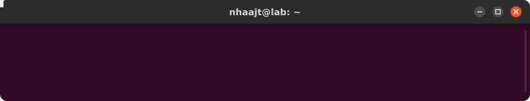

# Nhaajt

  

  <picture>
    <source media="(prefers-color-scheme: dark)" srcset="./avatar-decode-dark.svg" />
    
  </picture>

<em>
Student, still learning, and very happy about it. 
I like taking things apart to see how they work: a binary, a network, a bricked Spotify Car Thing. 
Right now I'm learning two things properly: running things in the cloud, and reading them back in assembly. 
Most of what's here is me learning in public, so expect rough edges and a lot of notes.
</em>

  <a href="https://www.nhaajt.com"><b>nhaajt.com</b></a> ·
  <a href="https://lab.nhaajt.com">lab</a> ·
  <a href="https://nhaajtt.github.io">notes</a> ·
  <a href="mailto:nhaajt.work@gmail.com">nhaajt.work@gmail.com</a>

---

## Now

cloud & infrastructure 
﹂**a two-server homelab I run and break myself** 
&nbsp;&nbsp;&nbsp;&nbsp;﹂Linux and Docker, container health checks, CPU / memory / temperature graphs over 24 h 
&nbsp;&nbsp;&nbsp;&nbsp;﹂locked down by default: firewall allow-lists, alerts on failed SSH logins and on any newly opened port 
&nbsp;&nbsp;&nbsp;&nbsp;﹂a desk device that can reach exactly one port on one server, nothing else ([carthing-desk-hub](https://github.com/nhaajtt/carthing-desk-hub)) 
﹂**a real-time multiplayer backend on Cloudflare Workers** ([chess rooms](https://github.com/nhaajtt/chess-in-the-margins/tree/main/server)) 
&nbsp;&nbsp;&nbsp;&nbsp;﹂one Durable Object per room, hibernating WebSockets, every move re-checked on the server 
&nbsp;&nbsp;&nbsp;&nbsp;﹂per-IP rate limits, an origin allow-list, socket caps, rooms that clean themselves up after a day 
&nbsp;&nbsp;&nbsp;&nbsp;﹂strict CSP and HSTS in front, tests for the abuse cases behind 
﹂**CI/CD I can trust**: tests on every push, CodeQL, actions pinned to commit SHAs, read-only tokens 
﹂**next**: Terraform for all of the above, then AWS (Cloud Practitioner → Solutions Architect Associate)

reverse engineering 
﹂**x86/x64 assembly and C**: learning to read what the compiler actually wrote 
﹂**Ghidra and x64dbg**: stepping through programs until they make sense 
﹂**CTFs and crackmes**: solving them, then writing down how (first notes coming to [nhaajtt.github.io](https://nhaajtt.github.io)) 
﹂**fuzzing**: found and reported a stack overflow in cJSON ([#1093](https://github.com/DaveGamble/cJSON/issues/1093)) 
﹂**malware analysis basics**: unpacking samples inside a throwaway VM, carefully

---

## Learning path

| | Cloud & infrastructure | Reverse engineering |
|---|---|---|
| **done** | two-server homelab: Docker, monitoring, security alerts · real-time backend on Durable Objects · hardened CI (pinned actions, CodeQL) | fuzzed cJSON and reported a stack overflow ([cJSON#1093](https://github.com/DaveGamble/cJSON/issues/1093)) |
| **now** | zero-trust networking with Tailscale ACLs · least-privilege containers · observability | x86/x64 assembly · Ghidra and x64dbg · CTFs and crackmes |
| **next** | Terraform · AWS Cloud Practitioner → Solutions Architect Associate · Kubernetes basics | unpacking · malware analysis basics in a lab VM |

  <picture>
    <source media="(prefers-color-scheme: dark)" srcset="./snake/snake-dark.svg" />
    
  </picture>

---

## Things I made

<table>
  <tr>
    <td width="50%" valign="top">
      <a href="https://github.com/nhaajtt/chess-in-the-margins"><b>chess-in-the-margins</b></a> 
      Chess drawn in ballpoint, every piece a creature. Own chess engine, online rooms on Cloudflare · <a href="https://chess.nhaajt.com">play it</a> 
       
      
    </td>
    <td width="50%" valign="top">
      <a href="https://orrery.nhaajt.com"><b>orrery</b></a> 
      Any GitHub profile drawn as planets, plus a GitHub Action that redraws it daily · <a href="https://orrery.nhaajt.com">try it</a> 
       
      
    </td>
  </tr>
  <tr>
    <td width="50%" valign="top">
      <a href="https://github.com/nhaajtt/carthing-desk-hub"><b>carthing-desk-hub</b></a> 
      A bricked Spotify Car Thing brought back as a desk hub: markets, news, weather, server health 
       
      
    </td>
    <td width="50%" valign="top">
      <a href="https://github.com/nhaajtt/shiftdrop"><b>shiftdrop</b></a> 
      Shift + drag any file for a wheel of actions: convert, compress, sign, share. Offline, Windows · <a href="https://shiftdrop.nhaajt.com">site</a> 
       
      
    </td>
  </tr>
</table>

More experiments, finished and unfinished, live on [lab.nhaajt.com](https://lab.nhaajt.com).

---

## Tiếng Việt

Chào bạn 👋 Ban ngày mình là sinh viên, ban đêm mình là kỹ sư cloud không lương cho chính cái homelab nhà mình.

- ☁️ **Cloud:** nhà có hai con server chạy 24/7. Tiền điện tăng, mình bảo với cái ví là "đang đầu tư cho tương lai". Ví không tin. Server thì tin, vì nó không có quyền phản đối.
- 🔍 **Reverse engineering:** hồi nhỏ mình tháo đồ chơi ra xem bên trong có gì, lớn lên chuyển sang tháo file `.exe`. Khác ở chỗ giờ không ai mắng nữa, chỉ có Ghidra im lặng nhìn mình lúc 3:17 am.
- 🐈 **Car Thing:** Spotify khai tử nó, mình nhặt về hồi sinh. Giờ nó đọc tin, xem giá vàng, nhắc lịch, lái xe quá 2 tiếng còn nhắc nghỉ. Sống có kỷ luật hơn cả chủ.
- 🔒 **Zero trust:** con Car Thing chỉ được nói chuyện với đúng một cổng trên một server. Mình gõ sai mật khẩu SSH cũng bị ghi sổ. Bị chính nhà mình nghi ngờ, cảm giác rất lạ nhưng rất an toàn.
- 🐛 **Bug đầu tiên:** tìm ra một lỗi stack overflow trong cJSON. Không phải Stack Overflow kia nha, cái kia mình chỉ vào copy thôi.
- ♟️ **Cờ vua:** viết hẳn một engine cờ, xong vẫn thua nó. Đó gọi là thành công.

Mọi thứ ở đây là mình học công khai: có cái xong, có cái dở, có cái dở dang từ hồi hứa "tuần sau làm tiếp". Nếu bạn cũng đang học thì nhắn mình nha, học chung đỡ cô đơn, debug chung đỡ khóc 🥲

<!-- quote:start -->
> 💬 **Câu nói hôm nay:** Một con server ngừng hoạt động là sự cố. Hai con ngừng cùng lúc là dấu hiệu nên đi ngủ.
<!-- quote:end -->

---

## Say hi

Learning buddies, CTF teammates, homelab tips, or a "you got this wrong": all welcome. 
📫 [nhaajt.work@gmail.com](mailto:nhaajt.work@gmail.com)
